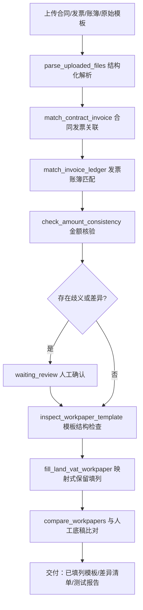

# 土增智填——合同发票账簿智能核验填表 作品说明

> 本文档由 `pnpm gen:materials` 于 2026-09-28 生成；应用效果数据来自平台数据库真实运行记录。

## 一、业务背景

面向土地增值税清算过程中工作底稿的资料采集、数据匹配与自动填列环节。事务所需要阅读工程合同提取关键条款、逐张查看发票、在账簿中寻找对应业务记录、建立合同-发票-账簿对应关系并核对金额后填入 Excel 底稿。一份合同对应多张发票和多笔账面记录时，人工处理容易出现重复、遗漏或错误匹配。

## 二、实现目标

- 工程合同、发票、账簿的结构化解析
- 一对一/一对多关联匹配与金额一致性核验
- 歧义与差异事项的人工确认闭环
- 事务所原始 Excel 模板的保留式自动填列（公式/合并/样式不破坏）
- 已填列底稿与人工底稿的逐格比对与准确率输出

## 三、技术路线

- Agent Runtime：Pi Agent SDK `@earendil-works/pi-coding-agent@0.87.1`（嵌入式会话，禁用内置 read/bash/edit/write）
- 联网检索：社区扩展 pi-web-access（Exa MCP 零配置）+ 自建 Bing/百度兜底抓取
- 引用可核验：结论引用链接可按需批量核验可达性（服务端 GET、8 秒超时、不下载正文，沿用内网地址拦截），结果分为可访问 / 拒绝自动访问（反爬，需人工确认）/ 失效 / 无法核验四级；核验结果按任务持久化（刷新不丢、时间线留痕），失效引用进入交付自检提醒与整页 MD，反爬不计入交付风险
- 前后端：React + Vite + Tailwind（深色专业工作台）/ Node.js + Fastify + SSE
- 存储与计算：SQLite（node:sqlite）/ ExcelJS / unpdf / tesseract.js（OCR）/ 整数分金额计算
- 会话与复核：按任务持久化会话（续跑恢复历史）/ waiting_review 人工复核状态机（完成态若遗留待复核问题，复核页可一键「转为待复核」重新打开）
- 交付与溯源：整页交付 MD 含元信息 / 目录 / 结论 / 联网引用（含核验结果、时效与证据力分级）/ 业务资料清单（类型、大小、上传时间、解析状态与解析结果）/ 产物溯源表（每份产物对应生成它的工具调用、生成或引用关系、所属运行与时间）/ 工具调用清单（按运行分组，含结果、耗时与入参摘要）/ 人工复核记录（已复核与待复核分列，含核对备注）；「打包下载」把整页 MD、机器可读的 manifest.json（任务元信息、交付自检结论、资料与产物溯源、工具与引用核验、引用证据力分级、金额与复核计数）与全部产物合成一个 zip（产物归入「产物/」目录，条目名做安全化），打包失败自动退回单文件 MD；交付区显示最近打包时间，并在打包后又有变更（新事件 / 产物更新 / 复核提交 / 金额核对 / 链接核验）时提示重新打包，避免发出过期交付包
- 金额可核对：结论中每处金额与工具结果、客户指令做三级比对（工具可溯源 / 来自客户指令 / 待人工确认），待确认金额在正文就地标注、点击即可标记为已核对（写入事件留痕、可撤销），复核页「结论金额核对」小节可集中处理并填写核对依据备注，备注与核对时间一并写入整页交付 MD，用以佐证「金额由确定性工具计算、模型零口算」
- 文号可核对：结论里的税收规范性文件文号按核心部分（如「〔2015〕119 号」「2017 年第 40 号」）归一化后在工具结果中匹配，分为有出处 / 无法核验（联网检索扩展只持久化查询元数据，如实标注而非当作有依据）/ 待人工确认三级，结果进结论要点区徽章、交付自检与整页 MD
- 引用可分级：Bing 取数优先走 RSS 输出（XML 结构稳定，不受推荐位与页面改版干扰；实测本机 HTML 结果页会返回与检索词完全无关的条目，同一检索词的 RSS 结果则真实对应），拿不到再退回 HTML 解析。检索结果按相关度过滤：检索词切成中文二元组与数字整词，门槛随检索词长度自适应（普通站点 20%、政府与税务机关站点 12%，下限由 TAXAI_SEARCH_MIN_RELEVANCE 控制），因此不会出现「都含『土地』就把《土地管理法》当成土地增值税清算依据」；门户首页 / 栏目入口 / 登录页与重复地址一律不进结果。引擎触发安全验证或结果全部无关时降级下一引擎，全部不可用则如实回报「未检索到」并逐引擎说明原因（含取数方式与过滤条数），不把无关网页塞进结论与引用清单。界面再把每条引用按证据力分为官方原文（政府/税务机关站点的具体文件页）/ 专业来源（机构或社区的具体文章页）/ 证据力弱（门户首页、百科词条、检索结果页）三级并给出判定理由，弱证据在引用芯片上转琥珀色、进入交付自检提醒与整页 MD，manifest.json 同步记录分级汇总，避免「拿百科词条当政策依据」
- 检索可留痕：界面区分「留下了来源」与「只留下查询元数据」两类联网检索。自建 search_public_cases / fetch_public_document 与扩展 fetch_content 都会留下标题与 URL（fetch_content 读过的政策法规库原文页此前不进引用清单，现已按同一口径纳入，真实任务引用从 29 条升到 40 条、其中政府与税务机关站点 23 条）；社区扩展 web_search 只写回查询词、条数、检索 ID 与 provider，因此「没有引用清单」不再被误报成「没有联网核验」，而是如实说明「执行过 N 次检索、扩展自报命中 M 条、未留存标题与 URL」，并给出补救动作（结论附检索词与检索时间，或改用自建工具留存来源）。引用清单上限 20 条并按 URL 去重，交付自检据此分为提醒与说明两级，manifest.json 记录 calls / withUrls / metadataOnly / reportedResults 与检索词、provider
- 文号可复查：「无法核验」与「待人工确认」不是终点——结论要点区的文号徽章可点开复查面板，一键用自建检索通道（Bing RSS 优先 + 相关度过滤）逐条联网复查。检索词自动补上发文机关（「按国税函〔2010〕220 号」→「国税函〔2010〕220号」）并给出去掉内部空格的紧凑写法作为第二种候选，第一种空手而归时自动换写法再查；判定分四级——找到公开出处（标题或摘要里确实出现该文号）/ 有候选待确认（检索到相关页面但没出现文号，不把候选当依据）/ 未检索到 / 检索失败。每条都记录实际检索词、逐引擎尝试过程与证据链接，按任务落库（刷新不丢）并写入事件留痕（交付包随之提示重新打包）；复查到出处的文号不再计入交付风险，整页 MD 的「政策文号溯源」节附复查表，manifest.json 记录四级计数与复查时间。实测某土增清算任务 3 处「无法核验」文号一键复查后全部找到公开出处
- 缺口看得见：平台应用效果看板在「全平台复核闭环缺口条」之外增加「全平台证据缺口条」——按作品分组列出仍有弱证据引用或待复查文号的任务，点击直达结果页处理（无缺口时转为翠绿并给出正向口径）。条上同时给出全平台数字：联网检索次数（留下来源 / 只留查询元数据）、引用总数与其中官方原文 / 证据力弱条数、检索拦下的无关结果与门户首页条数（过滤规则上线前的历史记录按现行规则回算，并明确标注是回算而非实时拦截）、政策文号总数（工具可溯源 / 待复查 / 已复查到公开出处）。这些数字与任务结果页、整页交付 MD、manifest.json 出自同一套纯函数，看板与交付材料不会对不上；实测当前口径为检索 31 次（留来源 12 / 仅元数据 19）、引用 40 条（官方 9 · 弱 25）、拦下 33 条、文号 31 处（可溯源 10 · 待复查 18 · 已复查到出处 3）、缺口任务 10 个
- 缺口可一键处理：证据缺口条上的「批量联网复查」两步确认后跨任务复查政策文号——待复查清单由服务端按任务重新计算（与结果页复查面板同一口径，不信任前端传清单），按预算切分（默认 12 处、硬上限 30，没有待办的任务不占预算），逐个任务判定落库并写入事件留痕，复查完自动刷新看板数字。实测一次点按覆盖 4 个任务 12 处文号：找到公开出处 9 处、候选待确认 1 处、未检索到 2 处，平台口径随即从「待复查 18 · 已复查到出处 3 · 缺口任务 10」变为「待复查 12 · 已复查到出处 9 · 缺口任务 9」

## 四、核心流程

## 五、工具清单

| 工具 | 分组 | 名称 | 职责 |
| --- | --- | --- | --- |
| 合同发票关联 | 业务工具 | `match_contract_invoice` | 按合同编号把发票关联到工程合同，支持一份合同对应多张发票。输出每份合同的发票清单、发票金额合计、合同与发票差异、未匹配发 |
| 发票账簿匹配 | 业务工具 | `match_invoice_ledger` | 把发票与财务账面记录关联。先按发票号码精确匹配（支持一张发票对应多笔账面记录），号码缺失时按金额唯一性给出候选并标记待人 |
| 金额一致性检查 | 业务工具 | `check_amount_consistency` | 对多组金额做确定性比对，输入项目名称、应有金额、实际金额与容差，输出每组的差异、是否一致及待核查结论。用于底稿金额与源数 |
| 公开案例联网检索 | 共用设施 | `search_public_cases` | 实时联网检索公开网页（Bing 为主、百度兜底）。当留存备查资料缺失、业务口径不明、或需要同类公开业务案例与税务机关公开 |
| 公开网页正文读取 | 共用设施 | `fetch_public_document` | 读取一个公开 http/https 网页的正文文本（自动去除导航与脚本），用于阅读 search_public_case |
| 解析上传资料 | 任务级工具 | `parse_uploaded_files` | 解析本任务已上传的业务资料（Excel/CSV/PDF/TXT），返回工作表名、表头、行记录或 PDF 文本等结构化数据 |
| 生成 Excel 工作底稿 | 任务级工具 | `generate_workpaper` | 生成可编辑的 Excel 专业工作底稿（表头样式、冻结首行、边框、数字格式与可选公式），保存到本任务产物目录，前端「生成 |
| 底稿逐格比对 | 任务级工具 | `compare_workpapers` | 比对两份 Excel 底稿（系统生成产物与人工完成参考底稿）。默认记录级比对：按表头行与主键列对齐记录，跨版式仍可比；a |
| 检查工作底稿模板 | 任务级工具 | `inspect_workpaper_template` | 读取上传的 Excel 工作底稿模板结构：工作表、行列范围、合并单元格、公式单元格分布与非空单元格清单（含地址）。填表前 |
| 填列土增清算底稿 | 任务级工具 | `fill_land_vat_workpaper` | 在原始 Excel 模板副本上保留式填列（保留全部公式、合并与样式，另存为新文件，原始模板不修改）。优先使用 mappe |

## 六、创新点

- 映射式填列：模型只给表头列名与数据行，地址定位/金额换算/公式避让由工具确定性完成
- 保留式写盘：在模板副本上写入，公式、合并单元格与样式零破坏，原始模板 sha256 校验不变
- 记录级比对：跨版式底稿按表头与主键对齐逐格比对，输出可直接入测试报告的准确率
- 异常不认定：差异只形成待核查事项并给出可能原因，不直接认定企业申报错误

## 七、应用效果（真实运行统计）

- 累计任务 6 个，其中已完成 2 个
- 工具调用 38 次，成功 37 次（成功率 97.37%）
- 生成专业底稿/产物 8 份
- 暂无记录级比对数据
- 自动化验证：verify:pi / verify:docs / verify:template / verify:policy / verify:compare / verify:ocr / verify:agents 全部 PASS（见 docs/testing/test-report-*.md）

## 八、演示与录屏清单

- [ ] 启动平台并选择本智能体（首页 KPI 与工具清单）
- [ ] 示例任务一键执行：执行时间线 + 工具折叠行 + 联网检索 chips
- [ ] 审查结论：Markdown 报告 + mermaid 图 + 引用 chips + 交付卡片
- [ ] 侧边阅读器：外链阅读模式 / Excel 工作表预览 / PDF 预览
- [ ] 模板保留式填列：已填列模板产物预览（公式列未触碰）
- [ ] 人工复核：waiting_review → 逐项确认 → completed；完成态遗留问题可重新打开复核
- [ ] 录屏要求：MP4、≤500MB、≤8 分钟，覆盖启动到交付全过程

## 九、边界与合规

- 不对接电子税务局/ERP/银行接口，不自动申报，不出具具法律效力的鉴证意见
- 业务 Agent 禁用 Pi 内置系统操作工具；上传文件类型与大小受限、路径隔离
- 模型密钥仅存服务端环境变量；客户资料默认不发送至第三方云模型（部署时可配置）
- 合成案例仅用于开发验证，正式测试使用经授权脱敏的真实案例
