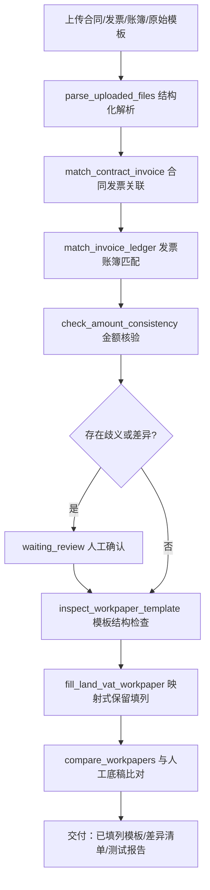

# 土增智填——合同发票账簿智能核验填表 作品说明

> 本文档由 `pnpm gen:materials` 于 2026-09-28 生成；应用效果数据来自平台数据库真实运行记录。

## 一、业务背景

面向土地增值税清算过程中工作底稿的资料采集、数据匹配与自动填列环节。事务所需要阅读工程合同提取关键条款、逐张查看发票、在账簿中寻找对应业务记录、建立合同-发票-账簿对应关系并核对金额后填入 Excel 底稿。一份合同对应多张发票和多笔账面记录时，人工处理容易出现重复、遗漏或错误匹配。

## 二、实现目标

- 工程合同、发票、账簿的结构化解析
- 一对一/一对多关联匹配与金额一致性核验
- 歧义与差异事项的人工确认闭环
- 事务所原始 Excel 模板的保留式自动填列（公式/合并/样式不破坏）
- 已填列底稿与人工底稿的逐格比对与准确率输出

## 三、技术路线

- Agent Runtime：Pi Agent SDK `@earendil-works/pi-coding-agent@0.87.1`（嵌入式会话，禁用内置 read/bash/edit/write）
- 联网检索：社区扩展 pi-web-access（Exa MCP 零配置）+ 自建 Bing/百度兜底抓取
- 前后端：React + Vite + Tailwind（深色专业工作台）/ Node.js + Fastify + SSE
- 存储与计算：SQLite（node:sqlite）/ ExcelJS / unpdf / tesseract.js（OCR）/ 整数分金额计算
- 会话与复核：按任务持久化会话（续跑恢复历史）/ waiting_review 人工复核状态机

## 四、核心流程

## 五、工具清单

| 工具 | 分组 | 名称 | 职责 |
| --- | --- | --- | --- |
| 合同发票关联 | 业务工具 | `match_contract_invoice` | 按合同编号把发票关联到工程合同，支持一份合同对应多张发票。输出每份合同的发票清单、发票金额合计、合同与发票差异、未匹配发 |
| 发票账簿匹配 | 业务工具 | `match_invoice_ledger` | 把发票与财务账面记录关联。先按发票号码精确匹配（支持一张发票对应多笔账面记录），号码缺失时按金额唯一性给出候选并标记待人 |
| 金额一致性检查 | 业务工具 | `check_amount_consistency` | 对多组金额做确定性比对，输入项目名称、应有金额、实际金额与容差，输出每组的差异、是否一致及待核查结论。用于底稿金额与源数 |
| 公开案例联网检索 | 共用设施 | `search_public_cases` | 实时联网检索公开网页（Bing 为主、百度兜底）。当留存备查资料缺失、业务口径不明、或需要同类公开业务案例与税务机关公开 |
| 公开网页正文读取 | 共用设施 | `fetch_public_document` | 读取一个公开 http/https 网页的正文文本（自动去除导航与脚本），用于阅读 search_public_case |
| 解析上传资料 | 任务级工具 | `parse_uploaded_files` | 解析本任务已上传的业务资料（Excel/CSV/PDF/TXT），返回工作表名、表头、行记录或 PDF 文本等结构化数据 |
| 生成 Excel 工作底稿 | 任务级工具 | `generate_workpaper` | 生成可编辑的 Excel 专业工作底稿（表头样式、冻结首行、边框、数字格式与可选公式），保存到本任务产物目录，前端「生成 |
| 底稿逐格比对 | 任务级工具 | `compare_workpapers` | 比对两份 Excel 底稿（系统生成产物与人工完成参考底稿）。默认记录级比对：按表头行与主键列对齐记录，跨版式仍可比；a |
| 检查工作底稿模板 | 任务级工具 | `inspect_workpaper_template` | 读取上传的 Excel 工作底稿模板结构：工作表、行列范围、合并单元格、公式单元格分布与非空单元格清单（含地址）。填表前 |
| 填列土增清算底稿 | 任务级工具 | `fill_land_vat_workpaper` | 在原始 Excel 模板副本上保留式填列（保留全部公式、合并与样式，另存为新文件，原始模板不修改）。优先使用 mappe |

## 六、创新点

- 映射式填列：模型只给表头列名与数据行，地址定位/金额换算/公式避让由工具确定性完成
- 保留式写盘：在模板副本上写入，公式、合并单元格与样式零破坏，原始模板 sha256 校验不变
- 记录级比对：跨版式底稿按表头与主键对齐逐格比对，输出可直接入测试报告的准确率
- 异常不认定：差异只形成待核查事项并给出可能原因，不直接认定企业申报错误

## 七、应用效果（真实运行统计）

- 累计任务 6 个，其中已完成 2 个
- 工具调用 38 次，成功 37 次（成功率 97.37%）
- 生成专业底稿/产物 8 份
- 暂无记录级比对数据
- 自动化验证：verify:pi / verify:docs / verify:template / verify:policy / verify:compare / verify:ocr / verify:agents 全部 PASS（见 docs/testing/test-report-*.md）

## 八、演示与录屏清单

- [ ] 启动平台并选择本智能体（首页 KPI 与工具清单）
- [ ] 示例任务一键执行：执行时间线 + 工具折叠行 + 联网检索 chips
- [ ] 审查结论：Markdown 报告 + mermaid 图 + 引用 chips + 交付卡片
- [ ] 侧边阅读器：外链阅读模式 / Excel 工作表预览 / PDF 预览
- [ ] 模板保留式填列：已填列模板产物预览（公式列未触碰）
- [ ] 人工复核：waiting_review → 逐项确认 → completed
- [ ] 录屏要求：MP4、≤500MB、≤8 分钟，覆盖启动到交付全过程

## 九、边界与合规

- 不对接电子税务局/ERP/银行接口，不自动申报，不出具具法律效力的鉴证意见
- 业务 Agent 禁用 Pi 内置系统操作工具；上传文件类型与大小受限、路径隔离
- 模型密钥仅存服务端环境变量；客户资料默认不发送至第三方云模型（部署时可配置）
- 合成案例仅用于开发验证，正式测试使用经授权脱敏的真实案例
