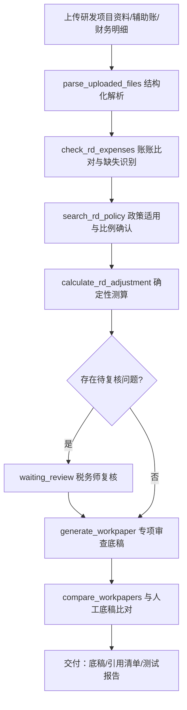

# 智研税审——研发费用加计扣除专项审查 作品说明

> 本文档由 `pnpm gen:materials` 于 2026-09-30 生成；应用效果数据来自平台数据库真实运行记录。

## 一、业务背景

面向企业研发费用加计扣除专项审查业务。事务所需要从研发项目资料、费用辅助账和企业财务记录中识别关键业务信息，检查费用归集情况，结合税收政策形成专业审查意见。传统方式下资料来源分散、辅助账与财务账需人工核对、不同费用类型涉及不同归集要求、专项审查底稿编制工作量大。

## 二、实现目标

- 研发项目资料与辅助账的结构化解析与信息提取
- 辅助账与财务明细账的账账比对、差异与缺失识别
- 按费用年度与企业类型确定性确认加计扣除比例及政策依据
- 其他相关费用限额与加计扣除额的程序化测算（整数分计算）
- 专项审查底稿生成、与人工底稿比对、税务师复核闭环

## 三、技术路线

- Agent Runtime：Pi Agent SDK `@earendil-works/pi-coding-agent@0.87.1`（嵌入式会话，禁用内置 read/bash/edit/write）
- 联网检索：社区扩展 pi-web-access（Exa MCP 零配置）+ 自建 Bing/百度兜底抓取
- 引用可核验：结论引用链接可按需批量核验可达性（服务端 GET、8 秒超时、不下载正文，沿用内网地址拦截），结果分为可访问 / 拒绝自动访问（反爬，需人工确认）/ 失效 / 无法核验四级；核验结果按任务持久化（刷新不丢、时间线留痕），失效引用进入交付自检提醒与整页 MD，反爬不计入交付风险
- 前后端：React + Vite + Tailwind（深色专业工作台）/ Node.js + Fastify + SSE
- 存储与计算：SQLite（node:sqlite）/ ExcelJS / unpdf / tesseract.js（OCR）/ 整数分金额计算
- 会话与复核：按任务持久化会话（续跑恢复历史）/ waiting_review 人工复核状态机（完成态若遗留待复核问题，复核页可一键「转为待复核」重新打开）
- 交付与溯源：整页交付 MD 含元信息 / 目录 / 结论 / 联网引用（含核验结果、时效与证据力分级）/ 业务资料清单（类型、大小、上传时间、解析状态与解析结果）/ 产物溯源表（每份产物对应生成它的工具调用、生成或引用关系、所属运行与时间）/ 工具调用清单（按运行分组，含结果、耗时与入参摘要）/ 人工复核记录（已复核与待复核分列，含核对备注）；「打包下载」把整页 MD、机器可读的 manifest.json（任务元信息、交付自检结论、资料与产物溯源、工具与引用核验、引用证据力分级、金额与复核计数）与全部产物合成一个 zip（产物归入「产物/」目录，条目名做安全化），打包失败自动退回单文件 MD；交付区显示最近打包时间，并在打包后又有变更（新事件 / 产物更新 / 复核提交 / 金额核对 / 链接核验）时提示重新打包，避免发出过期交付包
- 金额可核对：结论中每处金额与工具结果、客户指令做三级比对（工具可溯源 / 来自客户指令 / 待人工确认），待确认金额在正文就地标注、点击即可标记为已核对（写入事件留痕、可撤销），复核页「结论金额核对」小节可集中处理并填写核对依据备注，备注与核对时间一并写入整页交付 MD，用以佐证「金额由确定性工具计算、模型零口算」
- 文号可核对：结论里的税收规范性文件文号按核心部分（如「〔2015〕119 号」「2017 年第 40 号」）归一化后在工具结果中匹配，分为有出处 / 无法核验（联网检索扩展只持久化查询元数据，如实标注而非当作有依据）/ 待人工确认三级，结果进结论要点区徽章、交付自检与整页 MD
- 引用可分级：Bing 取数优先走 RSS 输出（XML 结构稳定，不受推荐位与页面改版干扰），但 RSS 要先过一道可用性判定——解析出的条目用与下游完全相同的过滤函数走一遍，留不下任何可用结果就说明这批是引擎兜底噪声，退回 HTML 解析。这道判定是实测换来的：只判断「解析出条数」时，本机 RSS 整批返回微软帮助页、Facebook 登录页一类与检索词无关的条目（条数照样是 10），HTML 通道被永久挡住、百度又被安全验证拦住，联网复查于是全部变成「未检索到」。两种取数方式谁可用会随本机网络环境变化（此前恰好相反，是 HTML 返回无关条目、RSS 真实对应），因此按结果判定而不写死优先级。Bing HTML 结果里的 www.bing.com/ck/a 跳转包装地址在解析阶段就还原成真实目标，否则来源域名会显示成 bing.com，既拿不到政府站点的权威判定与更低门槛、链接本身也可能失效。检索结果按相关度过滤：检索词切成中文二元组与数字整词，门槛随检索词长度自适应（普通站点 20%、政府与税务机关站点 12%，下限由 TAXAI_SEARCH_MIN_RELEVANCE 控制），因此不会出现「都含『土地』就把《土地管理法》当成土地增值税清算依据」；门户首页 / 栏目入口 / 登录页与重复地址一律不进结果。引擎触发安全验证或结果全部无关时降级下一引擎，全部不可用则如实回报「未检索到」并逐引擎说明原因（含取数方式与过滤条数），不把无关网页塞进结论与引用清单。界面再把每条引用按证据力分为官方来源（政府/税务机关站点上的具体页面；逐条判定理由再区分「政策法规库文件原文页」与「官方发布的政策解读页」——解读页由税务机关发布、证据力高于商业站点，但不是文件原文，作为依据前请核对原文）/ 专业来源（机构或社区的具体文章页）/ 证据力弱（门户首页、百科词条、检索结果页）三级并给出判定理由，弱证据在引用芯片上转琥珀色、进入交付自检提醒与整页 MD，manifest.json 同步记录分级汇总，避免「拿百科词条当政策依据」
- 检索可留痕：界面区分「留下了来源」与「只留下查询元数据」两类联网检索。自建 search_public_cases / fetch_public_document 与扩展 fetch_content 都会留下标题与 URL（fetch_content 读过的政策法规库原文页此前不进引用清单，现已按同一口径纳入，真实任务引用从 29 条升到 40 条、其中政府与税务机关站点 23 条）；社区扩展 web_search 只写回查询词、条数、检索 ID 与 provider，因此「没有引用清单」不再被误报成「没有联网核验」，而是如实说明「执行过 N 次检索、扩展自报命中 M 条、未留存标题与 URL」，并给出补救动作（结论附检索词与检索时间，或改用自建工具留存来源）。引用清单上限 20 条并按 URL 去重，交付自检据此分为提醒与说明两级，manifest.json 记录 calls / withUrls / metadataOnly / reportedResults 与检索词、provider
- 文号可复查：「无法核验」与「待人工确认」不是终点——结论要点区的文号徽章可点开复查面板，一键用自建检索通道（Bing RSS 优先 + 相关度过滤）逐条联网复查。检索词自动补上发文机关（「按国税函〔2010〕220 号」→「国税函〔2010〕220号」）并给出去掉内部空格的紧凑写法作为第二种候选，第一种空手而归时自动换写法再查；判定分四级——找到公开出处（标题或摘要里确实出现该文号）/ 有候选待确认（检索到相关页面但没出现文号，不把候选当依据）/ 未检索到 / 检索失败。每条都记录实际检索词、逐引擎尝试过程与证据链接，按任务落库（刷新不丢）并写入事件留痕（交付包随之提示重新打包）；复查到出处的文号不再计入交付风险，整页 MD 的「政策文号溯源」节附复查表，manifest.json 记录四级计数与复查时间。实测某土增清算任务 3 处「无法核验」文号一键复查后全部找到公开出处
- 缺口看得见：平台应用效果看板在「全平台复核闭环缺口条」之外增加「全平台证据缺口条」——按作品分组列出仍有弱证据引用或待复查文号的任务，点击直达结果页处理（无缺口时转为翠绿并给出正向口径）。条上同时给出全平台数字：联网检索次数（留下来源 / 只留查询元数据）、引用总数与其中官方原文 / 证据力弱条数、检索拦下的无关结果与门户首页条数（过滤规则上线前的历史记录按现行规则回算，并明确标注是回算而非实时拦截）、政策文号总数（有出处，其中复查取得 / 待复查 / 复查判定 matched）。这些数字与任务结果页、整页交付 MD、manifest.json 出自同一套纯函数，看板与交付材料不会对不上；本文档也在生成时取数，实测当前口径为检索 68 次（留来源 29 / 仅元数据 39）、引用 95 条（官方 48 · 弱 23）、拦下 69 条、文号 50 处（有出处 50，其中复查取得 15 · 待复查 0 · 复查判定 matched 26）、缺口任务 4 个
- 缺口可一键处理：证据缺口条上的「批量联网复查」两步确认后跨任务复查政策文号——待复查清单由服务端按任务重新计算（与结果页复查面板同一口径，不信任前端传清单），按预算切分（默认 12 处、硬上限 30 处，没有待办的任务不占预算），逐个任务判定落库并写入事件留痕，复查完自动刷新看板数字。每处理一个任务写一条事件，时间线上能逐条回看这次点按各自判成找到公开出处 / 候选待确认 / 未检索到多少处；本文档生成时的口径为文号 50 处（有出处 50，其中复查取得 15 · 待复查 0 · 复查判定 matched 26）
- 弱证据可替换：引用清单里判为「证据力弱」的条目（门户首页 / 百科词条 / 检索页）可一键检索官方替代来源。检索词 = 去掉站点后缀的标题 + 结论里出现最多的领域词（词表与结论关键词芯片共用 domain-keywords.ts，服务端从结论重算，不信任前端传词），并把这条引用自身排除在候选之外，避免「找到自己当作替代」；找到政府或税务机关站点的具体文件页记为「已找到替代来源」，只有专业文章时记为「候选待确认」，只检索到同类百科或首页时如实记为「未找到」。替代来源需人工确认后写回结论并重新打包，平台不改写 Agent 的结论；整页 MD 的「联网引用」节附替代来源表，manifest.json 记录 citationChecks 汇总与不变量。实测某研发费用任务 3 条弱证据引用一键检索后 2 条命中科技部的《研发费用加计扣除政策执行指引（2.0 版）》PDF，1 条如实回报未找到
- 补救可批量：证据缺口条上有两个批量入口——「批量复查文号」与「批量找替代来源」，都是两步确认、单次按服务端预算分批（默认 12 项、硬上限 30），待办清单由服务端按任务重新计算（不信任前端传清单），逐任务判定落库并写入事件留痕，跑完自动刷新看板数字。看板同时给出「其中 N 条已找到官方替代来源、待人工写回结论」，让补救进度可见而不是点完没反馈。替代来源要过两道主题关才判「找到官方原文」：既与原引用谈同一件事（共同词里要有涉税领域词，或两边出现同一个政策文号），又与这份结论谈同一件事（命中页要与结论里出现最多的领域词共享一个完整词条）；结论里取不到任何领域词时一律不判找到，降为候选交人工确认。实测这道门槛把 21 条引用复查里的「找到官方原文」从 20 条收敛到 4 条（均为科技部《研发费用加计扣除政策执行指引（2.0 版）》替换研发类百科词条），其余 17 条如实降为候选——被拦下的包括拿《土地管理法实施条例》替换「土地（汉语词语）_百度百科」、拿《中华人民共和国宪法》替换「中华人民共和国_百度百科」、拿《全面认识和把握我国基本国情》替换「国情_中国政府网」，它们只与原引用共用一个泛词，却会顺着修订指令扩散成假证据。看板与台账的「替代来源就绪」按同一口径实时计算，这个数字下降是把虚高改回真实值，不是能力退化
- 修订可回写：复查结果不停留在看板上——「生成修订指令」把已找到出处的文号、已找到替代来源的弱证据引用、以及仍未取得原文的项目整理成一条续跑指令，分三段列出（补文号出处 / 替换弱证据引用 / 标注未取得原文），每条附标题、URL 与检索时间，并明确要求「只改依据与引用，不要改动金额、测算过程、差异认定与结论意见」「修订后重新输出完整结论（保留原有表格与 mermaid 图）」「不得新增未经工具计算或联网核验的政策口径、文号与金额」。指令只填进「续跑任务」输入框，由税务师核对后提交——平台不自动改写 Agent 的结论，修订过程本身也留在会话历史与事件记录里
- 引用不漏项：联网引用清单同时从两处提取——工具留存的检索/读取结果，以及结论正文里直接写出的地址（政策快照给出的政策法规库链接、修订后由 Agent 写入的替代来源）；markdown 链接取链接文字作标题，裸链接按「末段文件名有意义就用它、否则用域名」生成可读标签，两处按 URL 去重合并（上限 24 条），每条都带来源标记（工具留存 / 结论正文，悬停可见）。实测口径下结论正文有 50 条地址、工具留存 40 条，合并去重后 72 条，其中政府与税务机关站点由 9 条升到 46 条——最该被核验的官方原文此前恰恰不在清单里，因此也从未被链接核验与证据力分级覆盖。平台看板给出「工具留存 N · 结论正文 M」的拆分；任务没有任何联网检索调用却仍有引用时，交付自检如实说明「引用取自结论正文，请用核验链接确认可达性并核对依据来源」，不把正文里的地址当作已联网核验
- 修订可量化：续跑改完结论后，结果页在「结论较上次运行变化」的句级增删之下给出「本次修订对证据的影响」——弱证据引用、官方原文、引用合计、政策文号四项的前后对比与总体判断（改善 / 退步 / 有增有减 / 质量持平），整页交付 MD 同步写入这一行与对比口径。口径只取结论正文（引用地址按证据力分级、文号按核心去重），不含跨运行累积的工具留存，因此不会把「工具结果越攒越多」误当成证据变好；总体判断只看弱证据与官方原文两项，避免「引用条数变了但质量没变」落进无结论可显示的空档。实测 20 个可对比的续跑任务中改善 4 · 有增有减 1 · 持平 15 · 退步 0
- 趋势看得见、改坏了拦得住：看板每天把关键指标存一份本地快照（最多 60 天），与 7 天前（或该日之前最近一次）快照对比给出环比箭头；证据类指标按「越低越好」着色——弱证据引用与待复查文号下降显示翠绿、上升显示琥珀，官方原文相反，不会把「弱证据变多」染成好消息。快照记录与裁剪、基线日选择、差值计算与方向判断全部抽在 metric-trend.ts（纯函数、不碰浏览器 API），KPI 与证据指标共用一套实现。交付自检同时接入修订影响：本次修订让证据质量退步（弱证据引用增加或官方原文减少）时给提醒「请核对修订内容后再交付」，有增有减给说明，改善给正向条目，质量持平或没有可对比的上一轮结论时不产生条目；manifest.json 记录修订前后两个完整快照与总体判断，并自校验「判断必须能由前后数值重新推出」，杜绝交付包里出现「判断说改善、数值说退步」
- 一页可签字：结果页交付区与整页交付 MD 都有「证据核对表」，把散在各处的证据口径收成一页九项——政策文号溯源、政策文号联网复查、联网引用证据力、弱证据替代来源检索、引用链接可达性、联网检索留痕、结论金额溯源、本次修订对证据的影响、交付自检，每项一句可核对的结论加一句说明（含时间与口径），表末是「交付前待办」清单（仍无出处的文号、待替换的弱证据引用、已失效链接，各列出具体条目）与核对人签字行。界面与 MD 共用 evidence-sheet.ts 的同一份生成逻辑，纸质交付不必翻整份材料；空输入一律如实兜底（未复查 / 未核验 / 无检索调用 / 无可对比轮次），不填占位数字
- 留痕省力气：核对表可单独导出（「下载核对表」出一页 Markdown、「复制」进剪贴板，与整页交付 MD 里的那一节同一份内容），纸质归档不必打印整份材料。复核页「结论金额核对」的备注框上方给了按作品区分的核对依据模板——智研税审第一条是「与研发支出辅助账明细逐笔核对一致」，土增智填是「与土地增值税清算底稿及合同发票台账核对一致」，其余五条两个作品通用（与底稿合计一致 / 与申报表一致 / 工具计算已复核 / 差异已列待核查 / 客户已说明）；点一下按分号追加、重复点同一条不会重复堆叠，另有「删上一段」回退。备注为空或过短时就地提示「备注会进整页交付 MD 与交付包，空着等于没有留痕」，避免为了省事留下没有依据的已核对标记
- 全平台一张台账：单任务核对表回答「这一份能不能签字」，平台总览底部的「全平台证据核对台账」回答「整个项目还欠什么」。台账每个任务一行、16 列，把文号有出处/总数、其中复查取得、待复查、复查到出处、引用数、官方来源、证据力弱、替代来源就绪、检索次数、仅元数据、拦下无关、金额待确认/总数、修订影响并排摆开，按欠账（弱证据引用 + 仍无出处的文号）倒序排列，末尾合计行给出任务数与仍有欠账的任务数；行内「打开任务」直接跳回原始证据，另有「下载 MD / 下载 CSV / 复制 MD」三个出口（CSV 带 BOM，Excel 打开不乱码、含逗号与引号的标题不串列）。台账各列求和与平台统计的对应聚合逐项相等，不会出现「看板一个数、台账另一个数」；导出即整改清单，数字不好看也如实呈现，不填占位数字
- 模板可以自己加：内置那几条覆盖不了每个所的口径，复核页「结论金额核对」右上角的「自定义模板」允许按作品补自己的常用依据（标签不超过 8 字、内容不少于 6 字、不带分号，与已有标签或内容重复会被当场拦下并说明原因，每个作品最多 8 条）。模板存在本机浏览器（localStorage，按作品分组），不进数据库、不影响其他人，也不参与任何对外统计；本地存了脏数据只丢那一条，不会让整个模板区消失。合并顺序固定为「作品专属内置 → 自定义 → 通用」并按标签去重，保证每次点出来的胶囊顺序一致
- 导出件不留执行口子：台账、底稿比对差异、任务清单三处 CSV 导出走同一份口径（apps/web/src/csv.ts）——UTF-8 BOM 加 CRLF 加引号转义，Excel 双击打开中文不乱码、含逗号与引号的标题不串列；另外防 CSV 公式注入：任务标题与底稿单元格来自用户输入或客户上传的文件，若以等号、加号、减号、@ 或制表符开头，Excel/WPS 打开会当公式执行（DDE 一类载荷），导出一律前置单引号让它变回文本，纯数字不加前缀，合计与计数拿到表里仍能求和。pnpm verify:csv 55 项覆盖转义、注入、按 RFC 4180 的往返解析，以及「不许再出现第二份手写转义」的静态走查
- 证据不会被自己抹掉：批量复查只挑真正没解决的目标（已找到公开出处的不再重复检索，预算不浪费），落库时还有一道不降级护栏——已经检索到公开出处是既成事实，后来某次检索没命中（联网通道本身有波动）不会把它覆盖成「未找到」，而是保留原有证据标题、地址与分级，把这次重试如实写进备注（含时间与本次判定）并追加检索尝试记录、更新复查时间。反向（从未找到升级为已找到）照常覆盖。也就是说点「批量复查文号」永远不会让看板上的证据变少，失败也不藏
- 替代来源有两道门槛：域名是政府或税务机关站点只是必要条件，页面还不能是入口页与功能页（首页、栏目页、登录检索页，以及 App 下载页、工具页一类没有文件内容的页面，index_pc.html / downloadApp / tools.html 这些变体都算），并且要与原引用有共同主题词——中文按二字滑窗粗分词、英文数字取 3 字以上，先剔掉「国家 / 政务 / 服务 / 平台 / 百科 / 税务」这类两边都会出现的通用词，剩下没有交集就只给「候选待人工确认」，不判成「已找到官方原文」。实测这道门槛拦下了把「国家政务服务平台」换成同域名 App 下载页、把「12366 纳税服务平台」换成 tools.html 的替换；对库里已有的 19 条官方替代来源逐条回算，没有一条被误伤
- 修订模式是机制不是嘱咐：点「生成修订指令」再续跑时，本轮会话里直接没有 generate_workpaper、compare_workpapers、fill_land_vat_workpaper、parse_uploaded_files 与测算核查类工具（黑名单在 revision-mode.ts，任务工具与智能体自带工具一起过滤），只保留联网检索与原文读取，因此补引用出处不会顺手把上一轮的底稿与比对记录换掉；run_started 事件写明本轮是修订模式，被停用的工具清单进服务端日志可追查。这条是实测换来的：早期只在指令里写「不要重跑业务工具」，模型照样重新生成了底稿，把记录级比对从 2/3 变成 0/54

## 四、核心流程

## 五、工具清单

| 工具 | 分组 | 名称 | 职责 |
| --- | --- | --- | --- |
| 研发费用加计扣除测算 | 业务工具 | `calculate_rd_adjustment` | 按确定性规则测算研发费用加计扣除金额。输入研发项目、费用年度、六大类归集金额与加计扣除比例，输出其他相关费用限额、超限金 |
| 研发费用归集核查 | 业务工具 | `check_rd_expenses` | 核查研发费用归集情况。输入研发支出辅助账、财务明细账与资料清单，输出按类别的金额比对、差异清单、缺失资料清单与待复核事项 |
| 研发费用政策适用检索 | 业务工具 | `search_rd_policy` | 检索研发费用加计扣除政策快照：按费用年度筛选适用政策、按关键词检索条文要点，并按年度与企业类型返回确定性加计扣除比例及政 |
| 公开案例联网检索 | 共用设施 | `search_public_cases` | 实时联网检索公开网页（Bing 为主、百度兜底）。当留存备查资料缺失、业务口径不明、或需要同类公开业务案例与税务机关公开 |
| 公开网页正文读取 | 共用设施 | `fetch_public_document` | 读取一个公开 http/https 网页的正文文本（自动去除导航与脚本），用于阅读 search_public_case |
| 解析上传资料 | 任务级工具 | `parse_uploaded_files` | 解析本任务已上传的业务资料（Excel/CSV/PDF/TXT），返回工作表名、表头、行记录或 PDF 文本等结构化数据 |
| 生成 Excel 工作底稿 | 任务级工具 | `generate_workpaper` | 生成可编辑的 Excel 专业工作底稿（表头样式、冻结首行、边框、数字格式与可选公式），保存到本任务产物目录，前端「生成 |
| 底稿逐格比对 | 任务级工具 | `compare_workpapers` | 比对两份 Excel 底稿（系统生成产物与人工完成参考底稿）。默认记录级比对：按表头行与主键列对齐记录，跨版式仍可比；a |

## 六、创新点

- 金额零口算：限额、基数、加计额全部由 TypeScript 工具以整数分确定性计算，模型只解释不计算
- 政策双保险：本地版本化政策快照给出比例与文号，正式引用前强制联网核验并记录核验时间
- 证据链贯穿：每项结论可追溯到文件、记录、字段与工具执行记录
- 复核状态机：存在待复核问题时任务进入 waiting_review，税务师逐项确认后才流转为已完成；问题清单由工具结果实时提取，若完成后才发现遗留问题，复核页「转为待复核」可重新打开复核
- 交付可签字：结果页一页「证据核对表」把九项证据口径收成可签字的一页（含交付前待办与核对人签字行），平台层再给一张全平台证据核对台账并可导出 MD/CSV，文号无出处、证据力弱、金额待确认逐项列明，不填占位数字

## 七、应用效果（真实运行统计）

- 累计任务 18 个，其中已完成 8 个
- 工具调用 117 次，成功 105 次（成功率 89.74%）
- 生成专业底稿/产物 15 份
- 与人工底稿记录级比对：总准确率 66.67%（4 次比对）。总准确率把「填错」与「两份底稿范围没对上」混在一个数里，拆开才说得清——一致率 66.67%（一致 2 / 填错 1，只看两边都有的项，回答「填得对不对」）、覆盖率 100%（人工底稿有的 2 项里自动填到 2 项，回答「填得全不全」）、仅自动底稿有 0 项；差异项均为预埋或真实口径差异，已列待核查
- 自动化验证：verify:pi / verify:docs / verify:template / verify:policy / verify:compare / verify:ocr / verify:agents 全部 PASS（见 docs/testing/test-report-*.md）

### 附录：与人工底稿差异明细（最近一次记录级比对）

- 总准确率 66.67%（比对 3：一致 2、差异 1、仅系统 0、仅人工 0）
- 差异项一律列为待核查事项，系统不按人工底稿自动"改正"。

| 类型 | 位置 | 系统底稿 | 人工底稿 |
| --- | --- | --- | --- |
| 差异 | 直接投入/金额（元） | 420000 | 425000 |

## 八、演示与录屏清单

- [ ] 启动平台并选择本智能体（首页 KPI 与工具清单）
- [ ] 示例任务一键执行：执行时间线 + 工具折叠行 + 联网检索 chips
- [ ] 审查结论：Markdown 报告 + mermaid 图（每张图可导出 PNG 与 SVG，文件名按序号与图类型区分）+ 引用 chips + 交付卡片
- [ ] 侧边阅读器：外链阅读模式 / Excel 工作表预览 / PDF 预览
- [ ] 政策依据：search_rd_policy 比例与文号 + 联网核验
- [ ] 人工复核：waiting_review → 逐项确认 → completed；完成态遗留问题可重新打开复核
- [ ] 录屏要求：MP4、≤500MB、≤8 分钟，覆盖启动到交付全过程

## 九、边界与合规

- 不对接电子税务局/ERP/银行接口，不自动申报，不出具具法律效力的鉴证意见
- 业务 Agent 禁用 Pi 内置系统操作工具；上传文件类型与大小受限、路径隔离
- 模型密钥仅存服务端环境变量；客户资料默认不发送至第三方云模型（部署时可配置）
- 合成案例仅用于开发验证，正式测试使用经授权脱敏的真实案例
