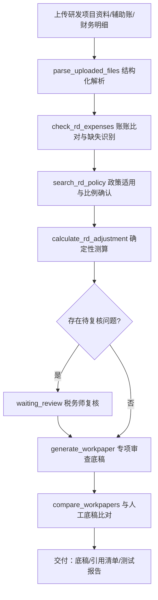

# 智研税审——研发费用加计扣除专项审查 作品说明

> 本文档由 `pnpm gen:materials` 于 2026-09-28 生成；应用效果数据来自平台数据库真实运行记录。

## 一、业务背景

面向企业研发费用加计扣除专项审查业务。事务所需要从研发项目资料、费用辅助账和企业财务记录中识别关键业务信息，检查费用归集情况，结合税收政策形成专业审查意见。传统方式下资料来源分散、辅助账与财务账需人工核对、不同费用类型涉及不同归集要求、专项审查底稿编制工作量大。

## 二、实现目标

- 研发项目资料与辅助账的结构化解析与信息提取
- 辅助账与财务明细账的账账比对、差异与缺失识别
- 按费用年度与企业类型确定性确认加计扣除比例及政策依据
- 其他相关费用限额与加计扣除额的程序化测算（整数分计算）
- 专项审查底稿生成、与人工底稿比对、税务师复核闭环

## 三、技术路线

- Agent Runtime：Pi Agent SDK `@earendil-works/pi-coding-agent@0.87.1`（嵌入式会话，禁用内置 read/bash/edit/write）
- 联网检索：社区扩展 pi-web-access（Exa MCP 零配置）+ 自建 Bing/百度兜底抓取
- 引用可核验：结论引用链接可按需批量核验可达性（服务端 GET、8 秒超时、不下载正文，沿用内网地址拦截），结果分为可访问 / 拒绝自动访问（反爬，需人工确认）/ 失效 / 无法核验四级；核验结果按任务持久化（刷新不丢、时间线留痕），失效引用进入交付自检提醒与整页 MD，反爬不计入交付风险
- 前后端：React + Vite + Tailwind（深色专业工作台）/ Node.js + Fastify + SSE
- 存储与计算：SQLite（node:sqlite）/ ExcelJS / unpdf / tesseract.js（OCR）/ 整数分金额计算
- 会话与复核：按任务持久化会话（续跑恢复历史）/ waiting_review 人工复核状态机（完成态若遗留待复核问题，复核页可一键「转为待复核」重新打开）
- 交付与溯源：整页交付 MD 含元信息 / 目录 / 结论 / 联网引用（含核验结果与时效）/ 业务资料清单（类型、大小、上传时间、解析状态与解析结果）/ 产物溯源表（每份产物对应生成它的工具调用、生成或引用关系、所属运行与时间）/ 工具调用清单（按运行分组，含结果、耗时与入参摘要）/ 人工复核记录（已复核与待复核分列，含核对备注）；「打包下载」把整页 MD、机器可读的 manifest.json（任务元信息、交付自检结论、资料与产物溯源、工具与引用核验、金额与复核计数）与全部产物合成一个 zip（产物归入「产物/」目录，条目名做安全化），打包失败自动退回单文件 MD
- 金额可核对：结论中每处金额与工具结果、客户指令做三级比对（工具可溯源 / 来自客户指令 / 待人工确认），待确认金额在正文就地标注、点击即可标记为已核对（写入事件留痕、可撤销），复核页「结论金额核对」小节可集中处理并填写核对依据备注，备注与核对时间一并写入整页交付 MD，用以佐证「金额由确定性工具计算、模型零口算」

## 四、核心流程

## 五、工具清单

| 工具 | 分组 | 名称 | 职责 |
| --- | --- | --- | --- |
| 研发费用加计扣除测算 | 业务工具 | `calculate_rd_adjustment` | 按确定性规则测算研发费用加计扣除金额。输入研发项目、费用年度、六大类归集金额与加计扣除比例，输出其他相关费用限额、超限金 |
| 研发费用归集核查 | 业务工具 | `check_rd_expenses` | 核查研发费用归集情况。输入研发支出辅助账、财务明细账与资料清单，输出按类别的金额比对、差异清单、缺失资料清单与待复核事项 |
| 研发费用政策适用检索 | 业务工具 | `search_rd_policy` | 检索研发费用加计扣除政策快照：按费用年度筛选适用政策、按关键词检索条文要点，并按年度与企业类型返回确定性加计扣除比例及政 |
| 公开案例联网检索 | 共用设施 | `search_public_cases` | 实时联网检索公开网页（Bing 为主、百度兜底）。当留存备查资料缺失、业务口径不明、或需要同类公开业务案例与税务机关公开 |
| 公开网页正文读取 | 共用设施 | `fetch_public_document` | 读取一个公开 http/https 网页的正文文本（自动去除导航与脚本），用于阅读 search_public_case |
| 解析上传资料 | 任务级工具 | `parse_uploaded_files` | 解析本任务已上传的业务资料（Excel/CSV/PDF/TXT），返回工作表名、表头、行记录或 PDF 文本等结构化数据 |
| 生成 Excel 工作底稿 | 任务级工具 | `generate_workpaper` | 生成可编辑的 Excel 专业工作底稿（表头样式、冻结首行、边框、数字格式与可选公式），保存到本任务产物目录，前端「生成 |
| 底稿逐格比对 | 任务级工具 | `compare_workpapers` | 比对两份 Excel 底稿（系统生成产物与人工完成参考底稿）。默认记录级比对：按表头行与主键列对齐记录，跨版式仍可比；a |

## 六、创新点

- 金额零口算：限额、基数、加计额全部由 TypeScript 工具以整数分确定性计算，模型只解释不计算
- 政策双保险：本地版本化政策快照给出比例与文号，正式引用前强制联网核验并记录核验时间
- 证据链贯穿：每项结论可追溯到文件、记录、字段与工具执行记录
- 复核状态机：存在待复核问题时任务进入 waiting_review，税务师逐项确认后才流转为已完成；问题清单由工具结果实时提取，若完成后才发现遗留问题，复核页「转为待复核」可重新打开复核

## 七、应用效果（真实运行统计）

- 累计任务 18 个，其中已完成 11 个
- 工具调用 74 次，成功 69 次（成功率 93.24%）
- 生成专业底稿/产物 12 份
- 与人工底稿记录级比对准确率 50%（2 次比对；差异项均为预埋或真实口径差异，已列待核查）
- 自动化验证：verify:pi / verify:docs / verify:template / verify:policy / verify:compare / verify:ocr / verify:agents 全部 PASS（见 docs/testing/test-report-*.md）

### 附录：与人工底稿差异明细（最近一次记录级比对）

- 总准确率 50%（比对 2：一致 1、差异 1、仅系统 0、仅人工 0）
- 差异项一律列为待核查事项，系统不按人工底稿自动"改正"。

| 类型 | 位置 | 系统底稿 | 人工底稿 |
| --- | --- | --- | --- |
| 差异 | 直接投入/金额（元） | 420000 | 425000 |

## 八、演示与录屏清单

- [ ] 启动平台并选择本智能体（首页 KPI 与工具清单）
- [ ] 示例任务一键执行：执行时间线 + 工具折叠行 + 联网检索 chips
- [ ] 审查结论：Markdown 报告 + mermaid 图 + 引用 chips + 交付卡片
- [ ] 侧边阅读器：外链阅读模式 / Excel 工作表预览 / PDF 预览
- [ ] 政策依据：search_rd_policy 比例与文号 + 联网核验
- [ ] 人工复核：waiting_review → 逐项确认 → completed；完成态遗留问题可重新打开复核
- [ ] 录屏要求：MP4、≤500MB、≤8 分钟，覆盖启动到交付全过程

## 九、边界与合规

- 不对接电子税务局/ERP/银行接口，不自动申报，不出具具法律效力的鉴证意见
- 业务 Agent 禁用 Pi 内置系统操作工具；上传文件类型与大小受限、路径隔离
- 模型密钥仅存服务端环境变量；客户资料默认不发送至第三方云模型（部署时可配置）
- 合成案例仅用于开发验证，正式测试使用经授权脱敏的真实案例
